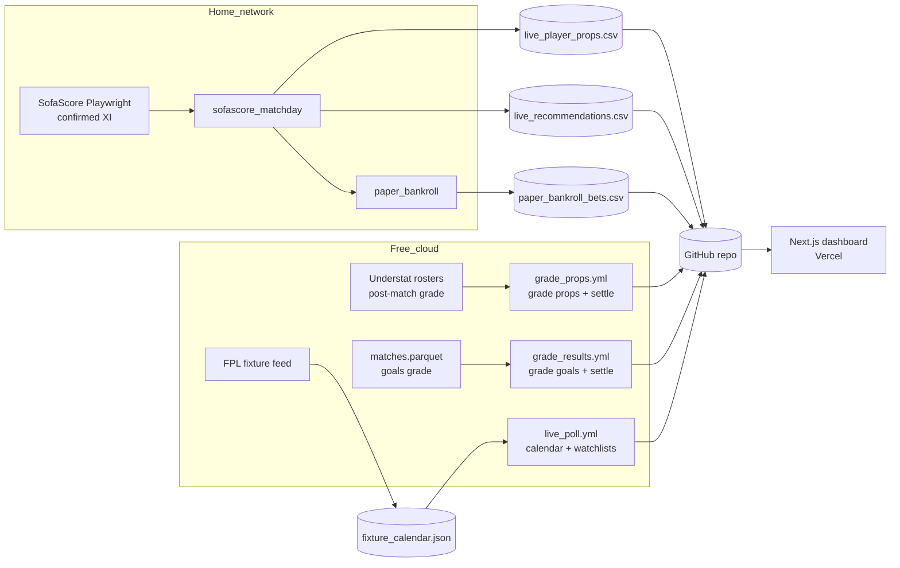

# ⚽ footymodel

[](https://footymodel.vercel.app/)


A stats-first football betting research project: does **positive expected
value (ROI) vs. bookmaker closing odds** exist anywhere in these markets, and
if so, where exactly? Not "does this predict football well" — a model can be
accurate and still lose money once the market's own margin is priced in.

Every claimed edge here has been walk-forward backtested (never trained on
future data) and calibration-checked before being trusted. Most markets
tested show **no edge**, and that's reported just as loudly as the ones that
do — see [Results at a glance](#results-at-a-glance) and the full
[`RESULTS.md`](RESULTS.md).

## Live dashboard

**[footymodel.vercel.app](https://footymodel.vercel.app/)**
— public view of the **Premier League** SofaScore paper-trading pipeline:
**player shots/SOT** and **goals Over/Under 2.5**. Tabs: **Predictions**,
**Goals O/U**, **Track record** (graded actuals + **€100 paper bankroll** when
synced from the repo), **Features**, and **Glossary**. Paper-trade only; no
login.

**Operating docs:** [`docs/SHOTS_SOT_OPERATING.md`](docs/SHOTS_SOT_OPERATING.md)
(match-week playbook), [`docs/PAPER_PROPS_EXPERIMENT.md`](docs/PAPER_PROPS_EXPERIMENT.md)
(staking rules).

## Table of contents

- [Live dashboard](#live-dashboard)
- [Results at a glance](#results-at-a-glance)
- [Core idea](#core-idea)
- [Architecture](#architecture)
- [Layout](#layout)
- [Setup](#setup)
- [Live player props — shots & SOT (production)](#live-player-props--shots--sot-production)
- [Phase 1 usage](#phase-1-usage)
- [Historical — goals O/U recommender](#historical--goals-ou-recommender)
- [Phase A — lineup-aware model (research)](#phase-a--lineup-aware-model-research)
- [Legacy live engines (not production)](#legacy-live-engines-not-production)
- [Checking performance](#checking-performance)
- [Roadmap](#roadmap)
- [Testing](#testing)
- [License](#license)

## Results at a glance

| Market / feature | Verdict | Key number |
|---|---|---|
| Over/Under, 1X2 (goals model) | ❌ No edge | CLV ≈ −0.2%, yield ≈ −7% |
| Asian Handicap (all 7 leagues) | ❌ No edge | best config +2.05% yield but −1.52% CLV — the "positive yield, negative CLV" noise trap |
| Lineup-aware total-goals accuracy | ✅ Confirmed | pooled t = 3.04 across all big-5 leagues |
| Closing-line goals O/U (historical) | ❌ No edge | see row above; live path is lineup-window paper only |
| Lineup-edge → live goals paper | 🔴 Active (hypothesis) | SofaScore match O/U + shared **€100** ledger — `live_recommendations.csv` |
| Player shots/SOT calibration | ✅ Well-calibrated | gaps mostly within ±0.03, full PL + Bundesliga seasons |
| Player shots/SOT → live paper | 🔴 Active | same bankroll — [dashboard](https://footymodel.vercel.app/) + `paper_bankroll_bets.csv` |

Full detail, per-league tables, and every rejected hypothesis (rest-days,
mid-tier lineup extension, etc.) are in [`RESULTS.md`](RESULTS.md).

## Core idea

Betting favorites gives a high hit rate and negative returns. We optimize for
**edge vs. the bookmaker's margin-stripped ("fair") probability**. Profit comes
from calibration + value detection + staking discipline, on top of a principled
statistical core (Dixon-Coles / Poisson).

## Architecture

**Production (live)** — player shots/SOT + goals O/U 2.5, zero paid live APIs:



**Research / legacy** (not used in production): Dixon-Coles closing-line backtests,
`recommend.py`, API-Football / RapidAPI / Apify engines — see [`RESULTS.md`](RESULTS.md).

The dashboard reads committed files from the repo (no separate database).
Props polling **must** run on a **home IP** (laptop script or self-hosted runner);
see [`docs/SHOTS_SOT_OPERATING.md`](docs/SHOTS_SOT_OPERATING.md).

## Layout

```
footymodel/
  config.py    # leagues, seasons, data source URLs, column maps
  data.py      # Phase 1 — download + normalize football-data.co.uk CSVs
  players.py   # Phase A — LineupModel (confirmed-lineup goals prediction)
  live/        # Phase B — live detection/paper-trade pipeline
    sofascore_matchday.py      # **production** — one poll: goals then props
    sofascore_props_engine.py  # PL player props + paper bets
    sofascore_engine.py        # lineup-aware goals O/U + paper bets
    paper_bankroll.py          # shared €100 ledger + staking
    paper_props_bankroll.py    # re-export shim
    sofascore_props_odds.py    # SofaScore player-prop odds (when exposed)
    shots_engine.py            # shots/SOT models + row builder
    calendar.py                # FPL calendar + idle-poll gate
    fpl_client.py              # free PL fixture feed
    match_detail.py            # JSONL: lineups + breakdown
    engine.py / rapidapi_engine.py / apify_engine.py  # legacy, not production
docs/
  SHOTS_SOT_OPERATING.md       # match-week playbook (start here)
  PAPER_PROPS_EXPERIMENT.md    # € bankroll rules
  SELF_HOSTED_PROPS.md         # laptop vs self-hosted runner
  MATCHDAY_AUTOMATION.md       # cron + calendar gate
dashboard/    # Next.js app (Vercel) — props + goals O/U public UI
data/
  raw/         # downloaded CSVs (gitignored)
  processed/   # normalized tidy tables + live logs (mostly gitignored,
               # tracked exceptions listed in .gitignore for the cron to
               # commit back to the repo)
```

## Setup

```bash
cd ~/footymodel
python3.11 -m venv .venv
. .venv/bin/activate
pip install -r requirements.txt
```

`requirements.txt` is the production lock file. Update dependency ranges in
`requirements.in`, then regenerate it with
`uv pip compile requirements.in --output-file requirements.txt --python-version 3.11`.

SofaScore props polling also needs Playwright Chromium:

```bash
playwright install chromium
```

## Live SofaScore paper trading (production)

**Scope:** Premier League only. Markets: player **shots** (1+/2+/3+),
**SOT** (1+/2+), and **Over/Under 2.5 goals** (lineup-aware). One internal
**€100** paper bankroll (`paper_props_bankroll.json`, ledger `paper_bankroll_bets.csv`).

| What | Command / workflow |
|------|---------------------|
| Match-week schedule (Irish time) | `PYTHONPATH=. python scripts/matchday_schedule.py` |
| **Poll + paper bets** (home Wi‑Fi) | `./scripts/matchday_laptop.sh loop 900 --push` |
| Bankroll summary | `python scripts/paper_props_summary.py` |
| Cloud calendar | `.github/workflows/live_poll.yml` |
| Cloud grade props + settle | `.github/workflows/grade_props.yml` |
| Cloud grade goals + settle | `.github/workflows/grade_results.yml` |
| Optional always-on home PC | `.github/workflows/live_poll_props_selfhosted.yml` |

Full playbook: [`docs/SHOTS_SOT_OPERATING.md`](docs/SHOTS_SOT_OPERATING.md). Goals plan: [`docs/GOALS_OU_PAPER_PLAN.md`](docs/GOALS_OU_PAPER_PLAN.md).

Dry-run (no network):

```bash
python scripts/sofascore_props_dryrun.py
python scripts/paper_props_bankroll_test.py
python scripts/goals_ou_math_audit.py
```

## Phase 1 usage

```bash
. .venv/bin/activate
python -m footymodel.data              # download + normalize default leagues/seasons
python -m footymodel.data --leagues E0 E1 N1 --seasons 2021 2022 2023 2024
```

Output: `data/processed/matches.parquet` — one tidy row per match.

## Historical — goals O/U recommender

> **Not part of the live product.** Kept for backtests and `paper_trades.csv`
> demos on historical football-data.co.uk odds.

The recommender fits the model on all history and outputs O/U value bets with
fractional-Kelly stakes for upcoming fixtures, logging them for paper-trading.

```bash
. .venv/bin/activate
# Demo on the latest matchday in the dataset (grades vs actual results):
python -m footymodel.recommend --league E1

# Live use next season — supply current fixtures + odds:
#   fixtures.csv columns: home_team,away_team,odds_over25,odds_under25
python -m footymodel.recommend --league E1 --fixtures fixtures.csv
```

Every run appends to `data/processed/paper_trades.csv`. Team names must match
football-data.co.uk spellings (e.g. "Sheffield United", "Nott'm Forest").

> **HONEST STATUS.** The goals/xG statistical model shows **no edge** vs. the
> market (`RESULTS.md`): O/U yield ~−7%, CLV ~−0.2%. The one confirmed
> exception is the **lineup-aware model** (Phase A below) — knowing the
> actual starting XI (attack + defence) measurably improves O/U prediction
> accuracy, replicated significantly across all 5 big-5 leagues (pooled
> t=3.04). **Live** lineup-window goals O/U is paper-traded on SofaScore (see
> [Live SofaScore paper trading](#live-sofascore-paper-trading-production)); closing-line
> backtests above remain the honest baseline.

## Phase A — lineup-aware model (research)

`players.py`'s `LineupModel` predicts total goals from the actual starting XI
(both attack AND defence ratings, not team averages) using scraped Understat
per-match rosters. This is the single model improvement that has held up under
rigorous cross-league testing in this project — see `RESULTS.md` for the full
big-5 confirmation (every league improved in the same direction, unlike an
earlier half-built version that didn't replicate).

```bash
python -m footymodel.understat                    # already run — big-5 xG cached
python scripts/build_players.py E0,SP1,D1,I1,F1    # scrape rosters (slow, cached)
python scripts/lineup_test.py E0,SP1,D1,I1,F1      # reproduce the t=3.04 confirmation
```

## Legacy live engines (not production)

Goals O/U live polling (`sofascore_engine.py`, `rapidapi_engine.py`, etc.) and
paid API keys are **legacy / local recovery only**. Production live data is:

- **Cloud:** `live_poll.yml` (calendar + watchlists), `grade_props.yml` (Understat grade + € settle).
- **Home network:** `sofascore_props_engine.py` via `matchday_laptop.sh` or
  `live_poll_props_selfhosted.yml`.

See [`docs/SELF_HOSTED_PROPS.md`](docs/SELF_HOSTED_PROPS.md). Optional `.env`
keys (`API_FOOTBALL_KEY`, `RAPIDAPI_KEY`, `APIFY_TOKEN`) are documented in
`.env.example` but **not required** for the props product.

Legacy dry-runs (mocked APIs, no quota):

```bash
python scripts/shots_live_dryrun.py
python scripts/live_dryrun.py          # goals engine only
python scripts/run_all_dryrun.py
```

## Checking performance

- **Dashboard → Track record:** graded props vs Understat + **€ paper bankroll** when ledger files are in the repo.
- **CLI:** `python scripts/paper_props_summary.py`
- **Historical goals paper:** `python scripts/live_summary.py` (legacy `live_recommendations.csv`)

## Roadmap

- [x] Phase 0 — scaffold
- [x] Phase 1 — data pipeline (`data.py`)
- [x] Phase 2 — Dixon-Coles goals engine (`model.py`)
- [x] Phase 2b — Understat xG integration (`understat.py`)
- [x] Phase 3 — value + backtest harness + CLV (`backtest.py`) → **no edge**
- [x] Phase 4 — O/U market-aware strategy + sweep (`strategy.py`)
- [x] Phase 5 — staking / bankroll (`staking.py`)
- [x] Phase 6 — recommender / paper-trade (`recommend.py`)
- [x] Phase A — lineup-aware model (`players.py`) → **confirmed edge, t=3.04**
- [x] Phase B — live lineup pipeline (`live/`) → live in production, polling
      via GitHub Actions every 20min
- [x] Phase C — Asian Handicap, all 7 leagues (`model.py` `predict_ah`,
      `scripts/ah_backtest.py`) → **no edge** (best config: +2.05% yield but
      CLV −1.52%, the "positive yield/negative CLV = noise" trap). Mid-tier
      lineup extension via FBref researched and confirmed not viable (no
      per-player xG for Championship/Eredivisie) — see RESULTS.md.
- [x] Phase D — Player shots-on-target via FBref (`footymodel/fbref.py`,
      `scripts/fbref_ingest_batch.py`, `scripts/fbref_sot_calibration_test.py`)
      → **well-calibrated on one PL season** (gaps within ±0.03 in populated
      buckets). See RESULTS.md Phase D.
- [x] Phase E — Player shots + SOT via WhoScored, real per-player minutes
      (`footymodel/whoscored.py`, `scripts/whoscored_calibration_test.py`)
      → **well-calibrated, full 380/380 PL 2023/24 season**. See RESULTS.md
      Phase E.
- [x] Phase F — Home/away venue factor for shots/SOT → **confirmed real**
      (~26%/22% higher home shots/SOT rate league-wide on PL). See RESULTS.md
      Phase F.
- [x] Phase G — Second-league robustness check (Bundesliga) → venue effect
      and calibration **both replicate with zero re-tuning**. See RESULTS.md
      Phase G.
- [x] Phase H — Merged live cron entry point (`live/run_all.py`) → goals and
      player-props engines now share ONE fixtures+lineups fetch per poll
      instead of two independent ones, which would have doubled API-Football
      usage past the Free-tier daily quota.
- [x] Phase I — Player-prop odds wired into `shots_engine.py`, same
      API-Football key as everything else. Forward paper-trade only (no
      historical prop-odds archive is reachable).
- [x] Phase J — Multi-source live resilience → added `rapidapi_engine.py`
      and `sofascore_engine.py` as fallbacks after API-Football's free tier
      was suspended once without warning (all three log to the same CSV,
      tagged by source); moved production polling from a local crontab to a
      GitHub Actions cron (`live_poll.yml`) so nothing depends on a machine
      staying on. SofaScore's fallback currently blocked by bot-detection on
      GitHub's shared runner IPs specifically — tracked, non-blocking.
- [x] Phase K — Public dashboard (`dashboard/`) → Next.js app on Vercel,
      reading live data straight from this (private) repo via the GitHub
      Contents API. Five tabs (Track record, Goals O/U, Player props,
      Staking, Glossary); expandable match cards showing the team-model vs.
      lineup-model breakdown and starting XI behind each Goals O/U
      prediction (`live/match_detail.py` logs the extra data, previously
      computed and discarded); mobile-responsive; past-kickoff predictions
      collapse into a "show N past predictions" disclosure instead of either
      cluttering the upcoming list or disappearing entirely.
- [x] Phase L — Scheduled training-data refresh (`refresh_training_data.yml`)
      → nothing was keeping `matches.parquet`/`matches_xg.parquet`/
      `player_match.parquet` current as the season progressed. Now runs
      daily in GitHub Actions, no laptop involved: full big-5 season history
      for match results/base xG (cheap, one request per league-season), but
      `build_players.py`'s per-match Understat roster scrape only refreshes
      the **current season** - re-scraping the full history daily would be
      thousands of redundant requests. Required fixing `build_players.py` to
      merge the refreshed season into the existing file instead of
      overwriting it wholesale (`merge_player_dataset()`, unit tested).
- [x] Phase M — Saved PL fixture calendar (`live/calendar.py`) → daily
      10-day kickoff snapshot so the dashboard can preview next weekend
      during a quiet midweek, idle live_poll ticks skip Playwright/API
      lineup fetches, and a delayed poll still queries yesterday when an
      unseen fixture sits in the 24h backward window. Missing/stale
      calendar fails open (runs the engines) rather than risking a miss.

## Testing

Most of this project's real correctness checks are backtests, not unit
tests — a walk-forward calibration table catches more than an assert would.
But a handful of non-trivial, data-independent logic paths do have
standalone pure-Python checks, run on every push via
[GitHub Actions](.github/workflows/ci.yml):

```bash
python scripts/ah_settlement_test.py
python scripts/goals_odds_parse_test.py
python scripts/props_odds_parse_test.py
python scripts/sofascore_odds_parse_test.py
python scripts/rapidapi_odds_parse_test.py
python scripts/apify_odds_parse_test.py
python scripts/grade_results_datetime_test.py
python scripts/grade_results_columns_test.py
python scripts/match_detail_test.py
python scripts/kelly_simulation_test.py
python scripts/calendar_test.py
```

Everything under `live/` additionally has a dry-run mode (mocked API
responses, no key or quota spent) — see
[Before spending API quota](#before-spending-api-quota--dry-run-tests-no-key-needed) above.
The dashboard (TypeScript, no test framework) is verified via `npx tsc
--noEmit` and `npm run build` on every change.

## License

Copyright © 2026 Tanam Sethi. All rights reserved. No license is granted to
copy, modify, or redistribute this code or its contents.
